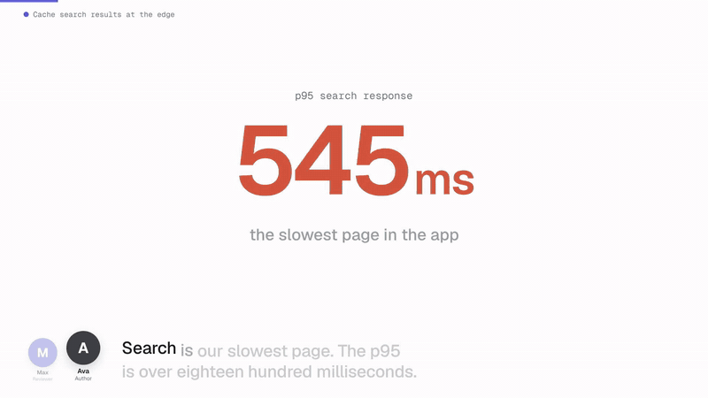

# sizzlr

**Plans and pull requests as two-voice review videos.**

Nobody reads the whole plan. sizzlr lets your coding agent turn a plan, a pull request or a design
doc into a short narrated video: two voices talking it through, the real code, the real numbers,
charts and diagrams that appear as they are mentioned. Everything renders on your machine. No
accounts, no API keys, no cloud.

[](docs/demo.mp4)

<sub>A silent teaser. [Watch the full video with sound](docs/demo.mp4).</sub>

## How it works

1. **Your agent writes a script.** Claude Code or Codex reads the plan or PR and writes a
   `script.json`: who says what, and which element is on screen while they say it.
2. **sizzlr speaks it.** [Kokoro](https://huggingface.co/hexgrad/Kokoro-82M) voices run locally on
   the CPU; silence is trimmed and the scenes follow the speech, word by word.
3. **sizzlr renders it.** Scenes are HTML, animated with the Web Animations API and rendered frame
   by frame to MP4 by [HyperFrames](https://github.com/heygen-com/hyperframes) in headless Chrome.

Next to every video you also get WebVTT subtitles, a Markdown transcript, chapter markers in the
MP4, a poster frame and a GIF teaser for places that don't play video.

## Requirements

- Node.js 22 or newer
- FFmpeg and Google Chrome (or Chromium) on the system
- About 90 MB of disk for the voice model, downloaded from Hugging Face on first use

`npx sizzlr doctor` checks all of it.

On Linux x64, the ONNX runtime tries to download CUDA binaries while installing. sizzlr runs on the
CPU and doesn't need them; skip the download with:

```bash
export ONNXRUNTIME_NODE_INSTALL_CUDA=skip
```

## Quick start

```bash
npx sizzlr init
```

That installs the sizzlr skill for both Claude Code (`.claude/skills/sizzlr/`) and Codex
(`.agents/skills/sizzlr/`) and writes a starter `sizzlr.config.json`. Then ask your agent:

> Make a sizzlr video of PR #123.

> Turn docs/plan.md into a sizzlr walkthrough with chapters.

The agent reads the source, writes the script, checks every number against the source, looks at a
contact sheet of the scenes and renders the video.

### Other ways to install the skill

```bash
npx sizzlr init --global          # for every project: ~/.claude/skills and ~/.agents/skills
npx skills add santosch/sizzlr    # with the skills CLI, for any agent it supports
```

In Claude Code, sizzlr is also a plugin:

```
/plugin marketplace add santosch/sizzlr
/plugin install sizzlr@sizzlr
```

## The CLI

The skill drives these; you can run them yourself too.

| Command | What it does |
| --- | --- |
| `sizzlr init` | install the skill, write `sizzlr.config.json` (`--global`, `--force`, `--no-skill`, `--no-config`) |
| `sizzlr lint <script>` | check a script against the schema and the catalogue's rules |
| `sizzlr build <script>` | speak the lines and write the HyperFrames project |
| `sizzlr snapshot <script>` | build, then save one still per scene as contact sheets (`--at 2,10,20` for other times) |
| `sizzlr render <script>` | build and render the MP4 and its companions (`--quality draft\|standard\|high`, `--no-extras`) |
| `sizzlr voices` | list the voices |
| `sizzlr schema` | print the script's JSON schema (`--out <dir>` writes both schemas) |
| `sizzlr doctor` | check Node, FFmpeg, Chrome and the voice model |

`<script>` is a `script.json` or a folder holding one. The project is written to `<name>.sizzlr/`
next to the script and the outputs to `<name>.mp4`, `.vtt`, `.transcript.md`, `.png` and `.gif`.
Speech is cached in `~/.cache/sizzlr` (`SIZZLR_CACHE` moves it), so rebuilding after an edit only
speaks the lines that changed.

## A script

```json
{
  "$schema": "https://raw.githubusercontent.com/santosch/sizzlr/main/schema/script.schema.json",
  "version": 1,
  "title": "Cache search results at the edge",
  "source": "PR #42",
  "cast": {
    "rev": { "name": "Max", "role": "Reviewer" },
    "auth": { "name": "Ava", "role": "Author" }
  },
  "scenes": [
    {
      "type": "big",
      "kicker": "p95 search response",
      "value": 1840, "countFrom": 0, "suffix": " ms", "tone": "bad",
      "lines": [{ "who": "auth", "text": "Search is our slowest page. The p95 is over eighteen hundred milliseconds." }]
    },
    {
      "type": "chain",
      "heading": "Check the cache ==first==",
      "nodes": [
        { "label": "Request", "at": 0 },
        { "label": "Edge cache", "tone": "accent", "at": 0, "word": 5 },
        { "label": "Database", "at": 1 }
      ],
      "lines": [
        { "who": "auth", "text": "Every search now asks the edge cache first." },
        { "who": "rev", "text": "And only misses reach the database?" }
      ]
    }
  ]
}
```

`at` is the line of the scene on which an item appears, `word` the word in that line, so things
land as they are said. `==marks==` get a marker stroke. Two full examples live in
[`examples/`](examples): [`sizzlr-intro`](examples/sizzlr-intro/script.json) and
[`tour`](examples/tour/script.json), which uses every element on a fictional PR.

## Elements

A closed catalogue, each with a job and things it is never used for. That keeps videos honest: no
bar charts of font sizes.

| Element | Use when |
| --- | --- |
| `title`, `punch` | the opening: a calm title, or the claim in under eight words |
| `big` | one striking measured number, counting up |
| `stats` | two or three headline numbers |
| `chart` | measured values with a real gap: bars, lines or areas, with an optional limit line |
| `code` | the few lines of the diff that are the change, with added and removed lines |
| `chain` | an order of steps or a call chain |
| `diagram` | a structure with branches, from Mermaid: flowcharts, sequences, states, entities |
| `layers` | levels that build on each other |
| `shot` | a real screenshot, with zooms and highlights on what is being talked about |
| `compare` | a before/after of a UI change as an illustration, with a verdict per side |
| `checks` | what was verified, with a sticker for the one awkward truth |
| `decisions` | the choices worth a second look: topic, decision, why |
| `chips` | what is included |
| `todo` | what is next or still open |
| `chapter` | chapters for videos over two minutes |
| `outro` | the last word, with a stamp |
| `custom` | the agent's own HTML and CSS when nothing else fits |

The full rules are in the [skill](skills/sizzlr/SKILL.md).

## Config

`sizzlr.config.json` sits in your project; the nearest one above the script applies. Every field
is optional.

```json
{
  "$schema": "https://raw.githubusercontent.com/santosch/sizzlr/main/schema/config.schema.json",
  "brand": { "name": "Acme" },
  "font": {
    "sans": { "family": "Inter", "file": "fonts/Inter-Variable.woff2" },
    "mono": { "family": "JetBrains Mono", "file": "fonts/JetBrainsMono.woff2" }
  },
  "colors": {
    "light": { "accent": "#0b6bcb" },
    "dark": { "accent": "#6aa9ff" }
  },
  "voices": [
    { "voice": "af_heart", "speed": 1.2 },
    { "voice": "bm_george", "speed": 1.15 }
  ],
  "style": { "background": "flat", "soundEffects": true, "disclaimer": "outro" },
  "render": { "quality": "draft", "fps": 30 }
}
```

- **Fonts** are files next to the config (`file`, or `files` with a weight each). The default is
  Geist and Geist Mono.
- **Colors** override any of the palette's tokens per theme: `background`, `surface`, `ink`,
  `muted`, `line`, `accent`, `second`, `good`, `warn`, `bad`, `highlight`.
- **Voices** are handed out in order to cast members without a voice of their own; two speakers
  never share one. `sizzlr voices` lists them all.
- **Style:** `background` is `flat` or `dots`; `disclaimer` puts a one-line "AI-generated from
  <source>" note in the `outro`, in a `corner`, or nowhere (`none`).
- **Render:** `draft` quality is the default and is plenty for review videos.

## Speed and cost

On four CPU cores a video renders in roughly two to three times its length: the 50-second intro
video renders in about two and a half minutes. Speech for a 50-second script takes about 40 seconds
the first time and nothing on rebuilds.

sizzlr itself costs nothing to run. The agent's work (reading the source and writing the script) is
a normal agent task; a two-minute PR video takes the agent a few minutes.

## Privacy

Nothing leaves your machine. The voice model is downloaded once from Hugging Face; after that,
sizzlr works offline. The rendered page has a content security policy that blocks network access,
and HyperFrames' usage telemetry is always switched off.

## Languages

English. Kokoro has voices for other languages, but the timing and the skill are tuned for English.

## Licence

sizzlr is [MIT](LICENSE).

Its voice pipeline uses [kokoro-js](https://github.com/hexgrad/kokoro) (Apache-2.0), which
phonemizes text with [eSpeak NG](https://github.com/espeak-ng/espeak-ng) compiled to WebAssembly
inside the `phonemizer` package. eSpeak NG is licensed under **GPL-3.0**. Installing and running
sizzlr is unaffected; if you redistribute sizzlr bundled together with its dependencies, the GPL
applies to that bundle's eSpeak NG part.

Other notable dependencies: HyperFrames (Apache-2.0), Mermaid (MIT), d3-scale and d3-shape (ISC),
Geist fonts (OFL-1.1), zod (MIT). FFmpeg and Chrome are used from the system and not bundled.

## Development

```bash
npm install            # .npmrc skips the CUDA download
npm run check          # typecheck, lint, tests
node src/cli.ts snapshot examples/tour
node src/cli.ts render examples/sizzlr-intro
```

See [AGENTS.md](AGENTS.md) for the code layout and conventions, and [PLAN.md](PLAN.md) for the
design.
